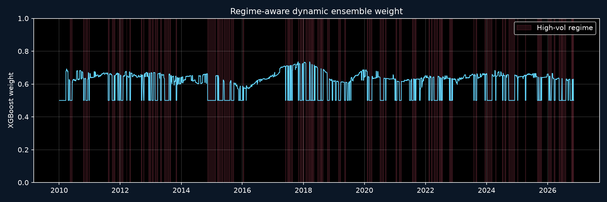
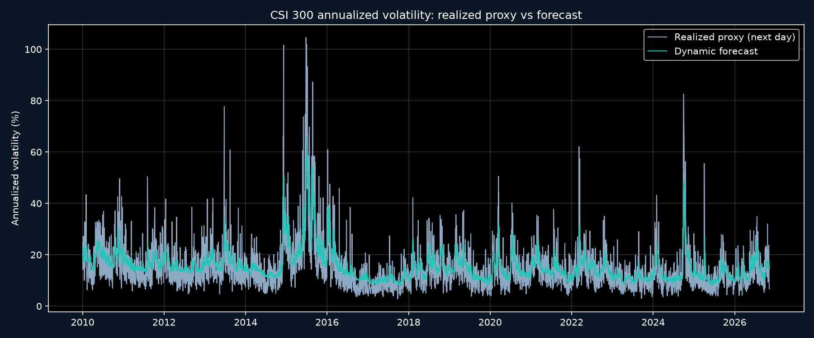
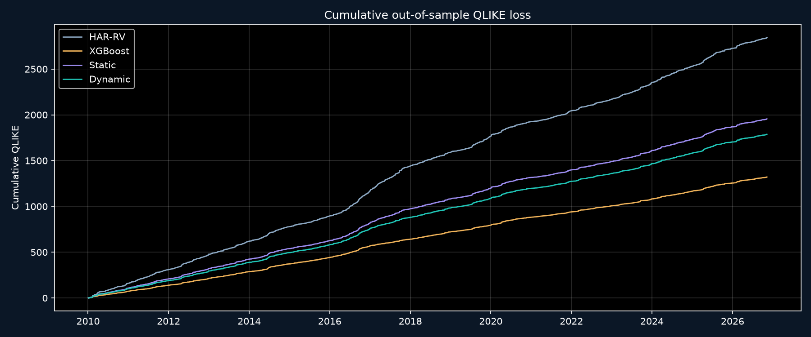

# 基于市场状态识别的AI波动率预测失效诊断与动态组合防御研究

> 自动生成实验报告。所有数值来自 `reports/forecasts.csv` 的真实滚动样本外预测；
> 运行标识与配置记录在 `experiments/run_metadata.json`。

## 摘要

本研究检验 HAR-RV、XGBoost、固定权重组合与基于历史样本外损失的状态感知动态组合
对沪深300下一交易日波动率的预测能力。样本外区间为 **2010-01-04
至 2026-11-09**，共 4090 个逐日预测。

动态组合整体 QLIKE 为 **0.43724**，
静态组合为 **0.47832**。
DM 统计量为 -12.993，双侧 p 值为 0.0000。 此结果只回答波动率预测，不构成指数涨跌方向预测。

### 核心解释

- 本样本中 XGBoost 的整体 QLIKE 为 **0.32314**，动态组合为
  **0.43724**。动态组合相对 XGBoost 的 DM 检验统计量为
  18.963，双侧 p 值为
  6.369e-77。
- 近似 10% MCS 保留的模型为：**XGBoost**。
- H1 得到支持：XGBoost 与 HAR 的预测损失差异很大。
- H2 的预期方向没有得到支持：XGBoost 在各状态中仍有最低 QLIKE；高波动下并没有出现
  “HAR 明显优于 AI”的失效逆转。
- H3 得到部分支持：动态组合显著优于固定组合，但没有击败纯 XGBoost。方向约束体现了
  防御思想，却在本样本中牺牲了 QLIKE 精度。

## 1. 研究假设

- H1：HAR-RV 与 XGBoost 的样本外波动率预测误差存在差异，但差异方向未必稳定。
- H2：机器学习模型在正常状态与高波动状态中的相对失效程度不同。
- H3：仅使用既往样本外误差构建的动态权重，在整体或部分市场状态下优于固定权重。

这些假设在查看最终测试结果前定义；阴性或不显著结果同样保留。

## 2. 数据与目标

- 标的：沪深300指数（000300）。
- 日线来源：东方财富公开历史行情接口，保留下载时间、行数、日期范围和 SHA-256
  校验和，见 `data/raw/*_manifest.json`。
- 目标：`RV(t+1)`，主实验使用 Garman–Klass 日度 OHLC 方差代理。
- 高频数据：系统支持 5 分钟收盘价计算真实日内 RV，但公开接口仅能返回近期滚动窗口，
  无法覆盖 2015 和 2020。因此近期 RV 单独保存，**没有把日线代理冒充为高频 RV**。
- 5 分钟 RV 排除隔夜收益，仅累加同一交易日内的 5 分钟对数收益平方，并要求至少 20 根
  完整 bar。
- 收益率单位：小数收益率；方差单位：日度方差；界面展示的波动率为乘 252 后的年化值。

## 3. 防止数据泄漏的设计

1. 每个预测起点 `t` 只使用收盘时已知的特征。
2. 训练样本必须满足 `target_date <= forecast_origin(t)`；次日目标从未进入当时拟合。
3. HAR 和 XGBoost 每 22 个交易日重训；XGBoost 每约 252 个样本外交易日做一次内部
   时间序列参数搜索。
4. 动态权重只读取当前预测之前的样本外预测损失，并按当前状态过滤历史同类状态。
5. 市场状态阈值使用先前 252 个交易日、排除当日的滚动分位数，并有连续确认机制。
6. 2015 与 2020 的日期只用于事后评价切片，不进入实时模型。

## 4. 模型

### HAR-RV

使用 `RV(d)`, `RV(w)`（5 日均值）和 `RV(m)`（22 日均值）对下一交易日方差做 OLS。
参数和每次重训时间保存在 `experiments/har_refits.json`。

### XGBoost

目标使用 `log(RV)`，预测后转换回方差空间并截断为正数。特征仅来自当日及以前，
包括多尺度 RV、波动分位、收益、成交量与成交额变化。参数在训练窗口内用
`TimeSeriesSplit` 优化，优化目标为验证集的 QLIKE，避免随机切分。

### 组合

固定组合权重为 0.5。动态组合按当前状态，在最近 252 个样本外预测中筛选同类状态，
用 HAR 与 XGBoost 历史平均 QLIKE 的反比例确定 XGBoost 权重，并向 0.5 收缩
20%。前瞻性假设下的方向约束为：
低/正常波动状态下 XGBoost 权重不低于 0.5，高波动状态下不高于 0.5；具体幅度仍由
既往同类状态样本外 QLIKE 决定，并非固定最优权重。

## 5. 主要结果

### 实验一：整体样本外比较

| model | n | mae | rmse | qlike | r2_ots | qlike_improvement_vs_har |
| --- | --- | --- | --- | --- | --- | --- |
| HAR-RV | 4090 | 8.3063e-05 | 0.0002 | 0.6955 | 0.4120 | 0 |
| XGBoost | 4090 | 6.7508e-05 | 0.0002 | 0.3231 | 0.4039 | 0.3723 |
| 固定组合 | 4090 | 7.2373e-05 | 0.0002 | 0.4783 | 0.4381 | 0.2171 |
| 动态组合 | 4090 | 7.1079e-05 | 0.0002 | 0.4372 | 0.4386 | 0.2582 |

### 实验二：市场状态分组

| regime | regime_label | model | n | mae | rmse | qlike | r2_ots |
| --- | --- | --- | --- | --- | --- | --- | --- |
| 0 | 低波动 | HAR-RV | 1162 | 5.2747e-05 | 7.9495e-05 | 0.7588 | 0.0832 |
| 0 | 低波动 | XGBoost | 1162 | 3.9838e-05 | 7.7608e-05 | 0.3377 | 0.1262 |
| 0 | 低波动 | 固定组合 | 1162 | 4.4578e-05 | 7.626e-05 | 0.5141 | 0.1563 |
| 0 | 低波动 | 动态组合 | 1162 | 4.2997e-05 | 7.6062e-05 | 0.4576 | 0.1607 |
| 1 | 正常波动 | HAR-RV | 1869 | 6.72e-05 | 0.0001 | 0.7056 | 0.1604 |
| 1 | 正常波动 | XGBoost | 1869 | 5.2914e-05 | 0.0001 | 0.3244 | 0.2003 |
| 1 | 正常波动 | 固定组合 | 1869 | 5.7889e-05 | 0.0001 | 0.4839 | 0.2164 |
| 1 | 正常波动 | 动态组合 | 1869 | 5.6038e-05 | 0.0001 | 0.4290 | 0.2186 |
| 2 | 高波动 | HAR-RV | 1059 | 0.0001 | 0.0003 | 0.6081 | 0.4204 |
| 2 | 高波动 | XGBoost | 1059 | 0.0001 | 0.0003 | 0.3049 | 0.4011 |
| 2 | 高波动 | 固定组合 | 1059 | 0.0001 | 0.0003 | 0.4293 | 0.4415 |
| 2 | 高波动 | 动态组合 | 1059 | 0.0001 | 0.0003 | 0.4293 | 0.4415 |

高波动状态平均 XGBoost 权重为 **0.500**，低波动状态为
**0.628**。权重每天由历史误差更新，不能据此断言某个固定状态总是
存在同一最优权重。

### 实验三：2015 年异常波动

| sample_start | sample_end | model | n | mae | rmse | qlike | r2_ots |
| --- | --- | --- | --- | --- | --- | --- | --- |
| 2015-06-01 | 2015-09-30 | pred_har | 85 | 0.0006 | 0.0008 | 0.5319 | 0.2915 |
| 2015-06-01 | 2015-09-30 | pred_xgb | 85 | 0.0005 | 0.0009 | 0.3037 | 0.2255 |
| 2015-06-01 | 2015-09-30 | pred_static | 85 | 0.0005 | 0.0008 | 0.3752 | 0.3099 |
| 2015-06-01 | 2015-09-30 | pred_dynamic | 85 | 0.0005 | 0.0008 | 0.3701 | 0.3103 |

### 实验四：2020 年疫情冲击

| sample_start | sample_end | model | n | mae | rmse | qlike | r2_ots |
| --- | --- | --- | --- | --- | --- | --- | --- |
| 2020-01-20 | 2020-04-30 | pred_har | 67 | 0.0001 | 0.0002 | 0.7492 | 0.1891 |
| 2020-01-20 | 2020-04-30 | pred_xgb | 67 | 9.2765e-05 | 0.0002 | 0.4703 | 0.2317 |
| 2020-01-20 | 2020-04-30 | pred_static | 67 | 9.6384e-05 | 0.0002 | 0.5850 | 0.2350 |
| 2020-01-20 | 2020-04-30 | pred_dynamic | 67 | 9.62e-05 | 0.0002 | 0.5649 | 0.2305 |

### 实验五：动态组合有效性

| model | n | mae | rmse | qlike | r2_ots |
| --- | --- | --- | --- | --- | --- |
| pred_har | 4090 | 8.3063e-05 | 0.0002 | 0.6955 | 0.4120 |
| pred_xgb | 4090 | 6.7508e-05 | 0.0002 | 0.3231 | 0.4039 |
| pred_static | 4090 | 7.2373e-05 | 0.0002 | 0.4783 | 0.4381 |
| pred_dynamic | 4090 | 7.1079e-05 | 0.0002 | 0.4372 | 0.4386 |

动态权重范围从 0.500 到 0.735。这是方向约束与历史
样本外误差共同产生的结果。权重变化图见
。

## 6. 统计检验

### Diebold-Mariano

HAC 滞后上限为 22。备用模型相对 HAR 或静态组合的
正 DM 值表示损失更高。

| model | benchmark | mean_loss_diff | dm_stat | dm_pvalue | n |
| --- | --- | --- | --- | --- | --- |
| XGBoost | HAR-RV | -0.3723 | -20.5207 | 3.7798e-89 | 4090 |
| Static Ensemble | HAR-RV | -0.2171 | -22.2101 | 2.8014e-103 | 4090 |
| Dynamic Ensemble | HAR-RV | -0.2582 | -20.4265 | 2.1828e-88 | 4090 |
| HAR-RV | Static Ensemble | 0.2171 | 22.2101 | 2.8014e-103 | 4090 |
| XGBoost | Static Ensemble | -0.1552 | -18.3261 | 3.6935e-72 | 4090 |
| Dynamic Ensemble | Static Ensemble | -0.0411 | -12.9928 | 7.4759e-38 | 4090 |

### Giacomini-White 条件预测能力

信息集工具变量为预测时点已经知道的市场状态哑变量；原假设是模型相对基准的
预期损失差不依赖于该状态。检验使用同一 Newey-West 滞后上限。

| model | benchmark | gw_stat | gw_pvalue | gw_df | n |
| --- | --- | --- | --- | --- | --- |
| XGBoost | HAR-RV | 494.5649 | 7.1868e-107 | 3 | 4090 |
| Static Ensemble | HAR-RV | 584.9320 | 1.8615e-126 | 3 | 4090 |
| Dynamic Ensemble | HAR-RV | 537.2089 | 4.1152e-116 | 3 | 4090 |
| HAR-RV | Static Ensemble | 584.9320 | 1.8615e-126 | 3 | 4090 |
| XGBoost | Static Ensemble | 385.7348 | 2.7225e-83 | 3 | 4090 |
| Dynamic Ensemble | Static Ensemble | 177.7021 | 2.7649e-38 | 3 | 4090 |

### Model Confidence Set（近似）

该实现使用成对损失差范围统计量和 circular block bootstrap。它是保留完整 MCS
逐步淘汰逻辑的操作化版本，不宣称为某一篇论文的完全官方实现。

| model | mean_loss | p_value | included | elimination_rank |
| --- | --- | --- | --- | --- |
| XGBoost | 0.3231 | 1 | True |  |
| Dynamic Ensemble | 0.4372 | 0.0005 | False | 3 |
| Static Ensemble | 0.4783 | 0.0005 | False | 2 |
| HAR-RV | 0.6955 | 0.0005 | False | 1 |

## 7. 稳健性与敏感性

### 固定权重敏感性

固定 XGBoost 权重从 0 到 1 的 QLIKE 最小值为
**0.32314**，对应权重
**1.00**。
完整结果见 `experiments/experiment_6_weight_sensitivity.csv`。

### 状态阈值敏感性

| low_quantile | high_quantile | high_regime_share | regime_switches | n | qlike | r2_ots |
| --- | --- | --- | --- | --- | --- | --- |
| 0.2000 | 0.7000 | 0.3120 | 404 | 4090 | 0.4398 | 0.4385 |
| 0.2000 | 0.7500 | 0.2565 | 400 | 4090 | 0.4374 | 0.4385 |
| 0.2000 | 0.8000 | 0.2108 | 368 | 4090 | 0.4353 | 0.4389 |
| 0.2500 | 0.7000 | 0.3171 | 408 | 4090 | 0.4398 | 0.4385 |
| 0.2500 | 0.7500 | 0.2589 | 411 | 4090 | 0.4372 | 0.4386 |
| 0.2500 | 0.8000 | 0.2137 | 380 | 4090 | 0.4352 | 0.4389 |
| 0.3000 | 0.7000 | 0.3156 | 418 | 4090 | 0.4398 | 0.4385 |
| 0.3000 | 0.7500 | 0.2592 | 423 | 4090 | 0.4373 | 0.4386 |
| 0.3000 | 0.8000 | 0.2137 | 394 | 4090 | 0.4353 | 0.4389 |

阈值结果可能揭示组合表现对状态定义的依赖性；如果最优阈值不稳定，不应将其解释为
可交易规律。

## 8. 时间序列诊断

- 日对数收益 ADF：统计量 -17.0375，
  p 值 0.000000。
- 日方差代理 ADF：统计量 -6.7583，
  p 值 0.000000。
- 平方收益滞后 1 自相关：0.1948。
- ARCH-LM 检验 p 值：3.44068e-52。
- 收益超额峰度：4.6093。

上述检验用于说明波动率聚类、厚尾和条件异方差背景，不用于挑选对结果有利的模型。

## 9. 最新状态与预警

- 截至 2026-11-10：高波动。
- 下一交易日动态年化波动率预测：13.47%。
- HAR 预测：14.82%；
  XGBoost 预测：11.97%。
- XGBoost 动态权重：0.500。
- 高风险预警：是。

预警是研究信号，不是交易建议；当前数据接口为日线，不适合盘中实时决策。

## 10. 局限与可验证边界

1. 主实验目标是 OHLC 范围方差代理，而不是完整历史的 5 分钟已实现方差。
2. 公开接口的近期 5 分钟数据不能对 2015/2020 事件进行高频复刻。
3. 指数日线接口的成交额和成交量定义由供应商提供，未与交易所逐笔数据交叉核验。
4. 动态权重根据历史预测误差学习，存在模型选择风险和状态样本不足风险。
5. MCS 为近似 bootstrap 实现；结论应结合 DM、效应大小和稳健性共同解释。
6. 未建模交易成本、仓位约束、极端流动性、隔夜跳空执行和指数可交易性。
7. 事件区间为中文市场常见事后诊断窗口，并非官方危机日期。

## 11. 复现

```powershell
.\scripts\run_full_research.ps1
```

或分别运行：

```powershell
.venv\Scripts\python.exe .\scripts\prepare_data.py
.venv\Scripts\python.exe -m pytest
.venv\Scripts\python.exe .\scripts\run_research.py
.venv\Scripts\streamlit.exe run .\dashboard\app.py
```




